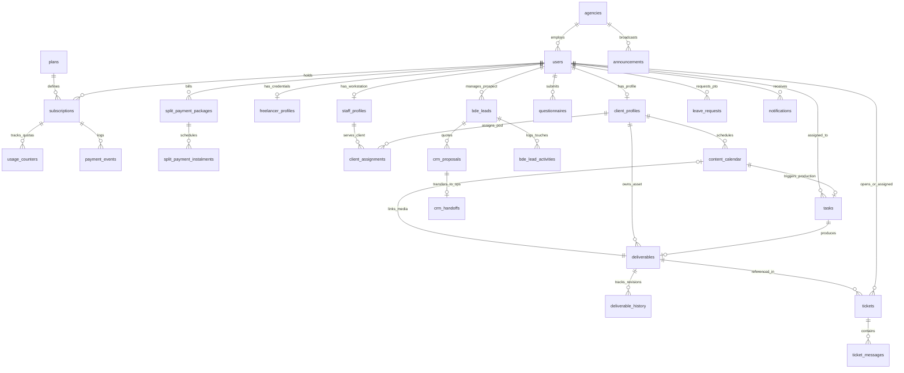
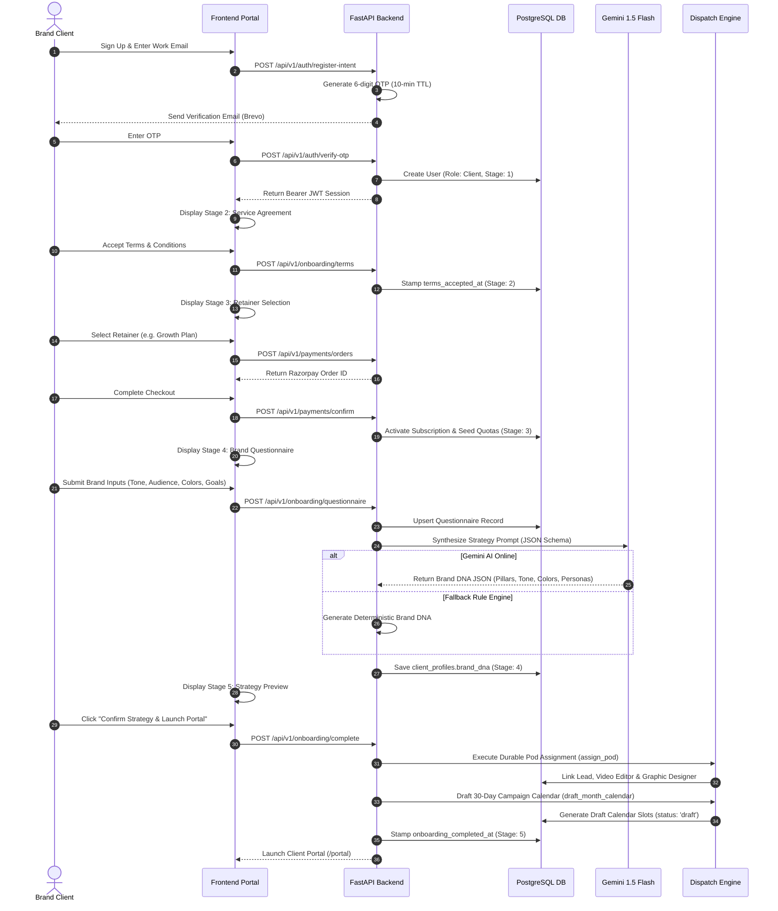
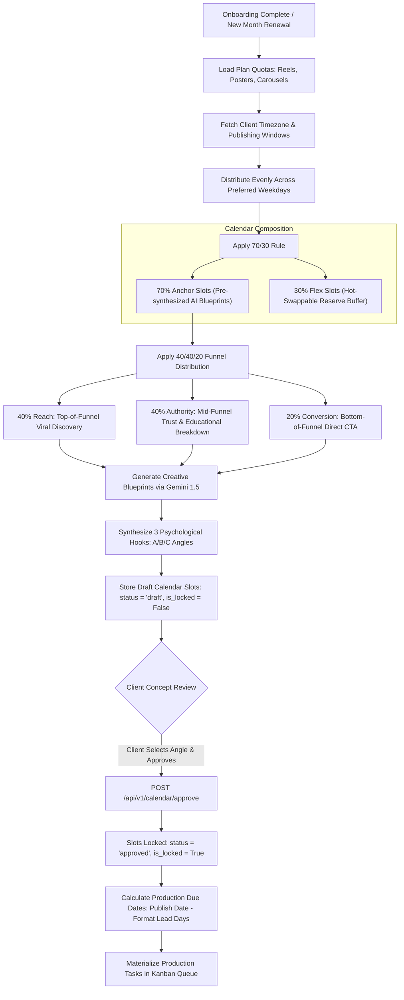
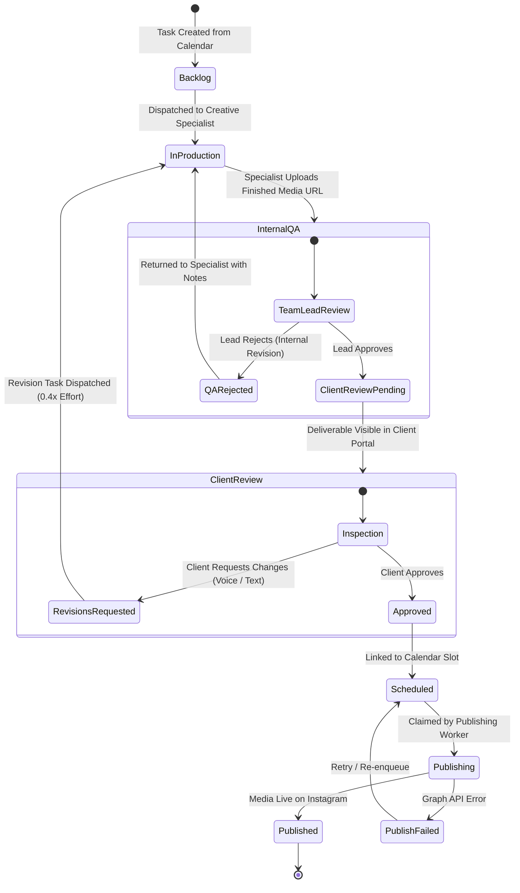
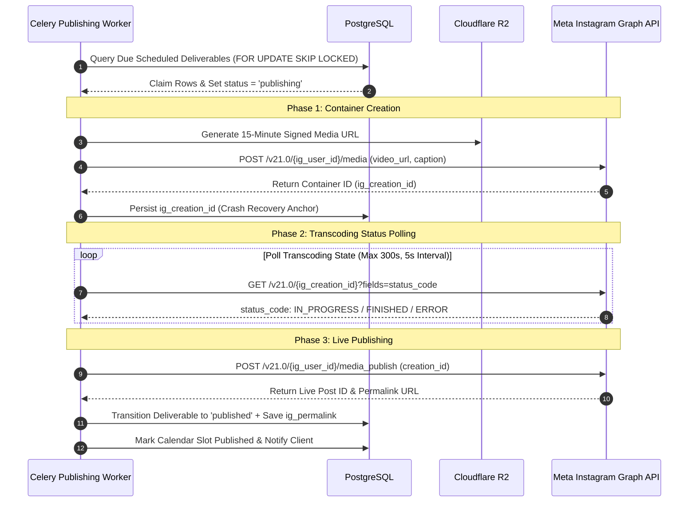

# 🚀 Creo — Complete System Architecture, Operational Workflows & All Dashboards

> **Platform Version:** 2.4.0 (Enterprise Production Architecture)  
> **Target Audience:** Engineering, Product, Operations, Creative Pod Leads, BDE Sales, and Agency Leadership  
> **Last Updated:** October 2026  

---

## 📑 Table of Contents

1. [Executive Overview & Platform Mission](#1-executive-overview--platform-mission)
2. [Canonical Production Architecture](#2-canonical-production-architecture)
   - [2.1 Tech Stack Matrix](#21-tech-stack-matrix)
   - [2.2 System Topology & Infrastructure Layout](#22-system-topology--infrastructure-layout)
   - [2.3 Monorepo & Directory Structure](#23-monorepo--directory-structure)
   - [2.4 Authentication, RBAC & Security Guardrails](#24-authentication-rbac--security-guardrails)
3. [Comprehensive Data Model & Entity Relationships](#3-comprehensive-data-model--entity-relationships)
   - [3.1 Entity Relationship Diagram (ERD)](#31-entity-relationship-diagram-erd)
   - [3.2 Database Schemas & Storage Design](#32-database-schemas--storage-design)
4. [End-to-End Operational Workflows & Algorithms](#4-end-to-end-operational-workflows--algorithms)
   - [4.1 Workflow 1: Client Onboarding & Brand DNA Synthesis](#41-workflow-1-client-onboarding--brand-dna-synthesis)
   - [4.2 Workflow 2: Billing, Retainers, Split Payments & Quotas](#42-workflow-2-billing-retainers-split-payments--quotas)
   - [4.3 Workflow 3: Quota Calendar Generation & 70/30 Blueprint Model](#43-workflow-3-quota-calendar-generation--7030-blueprint-model)
   - [4.4 Workflow 4: Unified Fair Dispatch Engine & Effort Points Algorithm](#44-workflow-4-unified-fair-dispatch-engine--effort-points-algorithm)
   - [4.5 Workflow 5: Creative Production, Internal QA & Voice-Guided Client Review](#45-workflow-5-creative-production-internal-qa--voice-guided-client-review)
   - [4.6 Workflow 6: Three-Phase Social Publishing Engine (Instagram Direct Graph API)](#46-workflow-6-three-phase-social-publishing-engine-instagram-direct-graph-api)
   - [4.7 Workflow 7: BDE & Revenue CRM Pipeline](#47-workflow-7-bde--revenue-crm-pipeline)
   - [4.8 Workflow 8: Freelancer Specialist Provisioning & Milestone Fee Routing](#48-workflow-8-freelancer-specialist-provisioning--milestone-fee-routing)
   - [4.9 Workflow 9: Support Ticketing, Escalations & SLA Compliance](#49-workflow-9-support-ticketing-escalations--sla-compliance)
   - [4.10 Workflow 10: Nightly Rebalance Sweeps, PTO Leaves & Capacity Protection](#410-workflow-10-nightly-rebalance-sweeps-pto-leaves--capacity-protection)
5. [Complete Catalog of All Dashboards](#5-complete-catalog-of-all-dashboards)
   - [5.1 Executive Admin Dashboard (`/admin`, `/admin/dashboard`)](#51-executive-admin-dashboard-admin-admindashboard)
   - [5.2 Team Productivity & Efficiency Intelligence Dashboard (`/admin/productivity`)](#52-team-productivity--efficiency-intelligence-dashboard-adminproductivity)
   - [5.3 BDE Outreach Oversight & Rep Leaderboard (`/admin/bde-oversight`)](#53-bde-outreach-oversight--rep-leaderboard-adminbde-oversight)
   - [5.4 Revenue CRM & Sales Pipeline Workspace (`/bde/crm/:section`, `/bde/legacy`)](#54-revenue-crm--sales-pipeline-workspace-bdecrmsection-bdelegacy)
   - [5.5 Pod Lead / Team Lead Operations Dashboard (`/team-lead/dashboard`, `/lead/dashboard`)](#55-pod-lead--team-lead-operations-dashboard-team-leaddashboard-leaddashboard)
   - [5.6 Creative Member Workstation & Mobile Dashboard (`/workstation`, `/member`)](#56-creative-member-workstation--mobile-dashboard-workstation-member)
   - [5.7 Client Portal Executive Dashboard (`/portal`)](#57-client-portal-executive-dashboard-portal)
   - [5.8 Deliverables Review & Contact Sheet (`/portal/deliverables`)](#58-deliverables-review--contact-sheet-portaldeliverables)
   - [5.9 Interactive Publishing Calendar (`/portal/calendar`, `/admin/calendar`)](#59-interactive-publishing-calendar-portalcalendar-admincalendar)
   - [5.10 Billing, Subscriptions & Split Payments Portal (`/portal/payments`, `/admin/revenue`)](#510-billing-subscriptions--split-payments-portal-portalpayments-adminrevenue)
   - [5.11 Specialist Support Desk & Ticket Drawer (`/portal/support`, `/admin/support`)](#511-specialist-support-desk--ticket-drawer-portalsupport-adminsupport)
   - [5.12 Brand DNA & Strategy Portal (`/portal/brand`, `/admin/clients/:clientId/brand`)](#512-brand-dna--strategy-portal-portalbrand-adminclientsclientidbrand)
   - [5.13 Freelancer Specialist Workspace (`/freelancer/tasks`)](#513-freelancer-specialist-workspace-freelancertasks)
   - [5.14 Social Publishing Queue & Automation Dashboard (`/admin/publishing`)](#514-social-publishing-queue--automation-dashboard-adminpublishing)
   - [5.15 SLA Performance & Compliance Dashboard (`/admin/support/sla`)](#515-sla-performance--compliance-dashboard-adminsupportsla)
   - [5.16 Client Roster & Account Operations Dashboard (`/admin/clients`)](#516-client-roster--account-operations-dashboard-adminclients)
   - [5.17 Team Pod Management & Staff Capacity Dashboard (`/admin/teams`)](#517-team-pod-management--staff-capacity-dashboard-adminteams)
   - [5.18 Leave Approvals & PTO Schedule Dashboard (`/admin/leave`, `/team-lead/schedule`)](#518-leave-approvals--pto-schedule-dashboard-adminleave-team-leadschedule)
   - [5.19 Slack & Pod Communication Hub (`/slack`)](#519-slack--pod-communication-hub-slack)
   - [5.20 System Health & Diagnostic Monitor (`/health`)](#520-system-health--diagnostic-monitor-health)
6. [Cross-Dashboard Propagation & Real-Time Sync](#6-cross-dashboard-propagation--real-time-sync)
7. [Role-Based Access Control (RBAC) Matrix](#7-role-based-access-control-rbac-matrix)
8. [Production Deployment, Maintenance & Invariants](#8-production-deployment-maintenance--invariants)

---

## 1. Executive Overview & Platform Mission

**Creo** is an enterprise-grade digital marketing agency operating system and creative operations platform engineered specifically for high-growth direct-to-consumer (D2C) brands and modern creative agencies. 

The platform bridges the gap between client-facing creative collaboration and agency operational execution. It solves the core bottlenecks in digital agency scaling:
- **Chaotic Client Onboarding:** Automating client setup via a 5-stage self-serve onboarding engine, instant Razorpay retainer capture, and automated Gemini 1.5 Flash AI **Brand DNA** extraction.
- **Capacity Collapse & Burnout:** Eliminating manual task routing through an intelligent **Effort-Point Dispatch Engine** that balances workload using rolling delivery windows, skill affinities, and PTO leave awareness.
- **Revision Hell:** Streamlining client feedback through native 9:16 vertical reels review, in-browser **Voice Feedback Recording/Waveform Scrubbing**, and automated revision allowance tracking.
- **Multi-Account Social Media Delivery:** Fully automating direct Instagram professional content dispatch without requiring legacy Facebook Page linkage via **Direct Instagram Login for Business**.
- **Revenue & Pipeline Tracking:** Unifying sales leads, quota governance, custom proposal generation with server-side minor-unit calculations, and delivery handoffs inside a dedicated **BDE Revenue CRM**.

---

## 2. Canonical Production Architecture

Creo is architected as a high-performance, decoupled client-server platform optimized for edge delivery, sub-second API latencies, zero egress media storage costs, and strict relational multi-tenancy.

### 2.1 Tech Stack Matrix

| Architectural Layer | Technology Choice | Production Role & Key Capabilities |
| :--- | :--- | :--- |
| **Frontend Framework** | **React 19 + Vite 6 + TypeScript** | Ultra-responsive Single Page Application (SPA), code-split chunks, fast HMR |
| **Styling & Motion** | **Tailwind CSS v4 + Motion** | Bento-box dark UI (`#0B111C`), fluid micro-interactions, hardware-accelerated transitions |
| **Interactive UX** | **@dnd-kit + Radix UI Primitives** | Accessible modal dialogs, accessible drag-and-drop Kanban boards, popovers |
| **Client-Side State** | **TanStack Query v5 (React Query)** | Optimistic updates, declarative window polling (5s–30s), automated cache invalidation |
| **Frontend Hosting** | **Cloudflare Pages** | Zero-latency worldwide edge CDN distribution, $0 bandwidth fees, atomic git deployments |
| **DNS, CDN & WAF** | **Cloudflare Free / Pro Tier** | Global DDoS mitigation, automatic SSL termination, HTTP/3, and edge route caching |
| **Backend API** | **FastAPI (Python 3.11+)** | High-throughput async ASGI engine, Pydantic v2 schemas, strict type validation |
| **ORM & Database Client** | **SQLAlchemy 2.0 (asyncio)** | Asynchronous PostgreSQL driver (`asyncpg`), connection pooling, statement caching |
| **Relational Database** | **Supabase PostgreSQL 15+** | Relational integrity, foreign keys, row-level security (RLS), ACID transactions |
| **Database Migrations** | **Alembic** | Version-controlled, declarative migration scripts (`0001` through `0019+`) |
| **Cache & Key-Value Store** | **Upstash Redis (Serverless)** | Ephemeral auth tokens, sliding-window rate limiters, token revocation blacklist |
| **Asynchronous Worker Engine** | **Celery 5.3+ & Celery Beat** | Scheduled background sweeps, rolling horizon dispatch, periodic health checks |
| **Media & Asset Storage** | **Cloudflare R2 (S3-Compatible)** | 5 TB multi-tenant media bucket with **$0 network egress fees** |
| **Media Ingestion & Streaming** | **Direct Pre-Signed S3 URLs** | Browser-to-R2 pre-signed PUT (512 MB ceiling); 15-minute expiring private pre-signed GETs |
| **AI Strategy Engine** | **Google Gemini 1.5 Flash** | Structured JSON Brand DNA synthesis, psychological hooks, and 30-day blueprints |
| **Payment Gateway** | **Razorpay PG & Subscriptions** | Recurring monthly retainers, split milestone instalment packages, webhook HMAC validation |
| **Social Publishing API** | **Meta Graph API v21.0** | Direct Instagram Business Container creation, transcoding polling, and automated publishing |
| **Transactional Email** | **Brevo (Sendinblue) HTTPS API** | OTP delivery, password reset tokens, weekly client digests, split payment invoices |
| **Health Monitoring** | **UptimeRobot Free + Health Probe** | Real-time synthetic monitoring hitting `/health` and `/api/v1/health` every 60s |

---

### 2.2 System Topology & Infrastructure Layout

```mermaid
flowchart TD
    subgraph Clients["Clients & Agency Staff"]
        Browser["Desktop & Mobile Browsers<br/>(React 19 SPA)"]
    end

    subgraph Edge["Cloudflare Edge Network"]
        CFDNS["Cloudflare DNS & WAF"]
        CFPages["Cloudflare Pages<br/>(Frontend Assets CDN)"]
        R2["Cloudflare R2 Bucket<br/>(Creative Assets & Reels)"]
    end

    subgraph Compute["Application Backend (Render)"]
        FastAPI["FastAPI Async API Server<br/>(Python 3.11+ / Uvicorn)"]
        CeleryWorker["Celery Worker Pod<br/>(Async Publish & Video Transcode)"]
        CeleryBeat["Celery Beat Scheduler<br/>(Cron & Nightly Sweeps)"]
    end

    subgraph DataStore["Data & Message Persistence"]
        Postgres[("Supabase PostgreSQL 15+<br/>(Multi-Tenant Schemas)")]
        Redis[("Upstash Redis<br/>(Queue Broker & Cache)")]
    end

    subgraph External["External Service Integrations"]
        Razorpay["Razorpay Gateway<br/>(Webhooks & Autopay)"]
        Gemini["Google Gemini 1.5 Flash<br/>(Brand DNA & Blueprints)"]
        MetaGraph["Meta Instagram Graph API<br/>(Direct Business Publishing)"]
        Brevo["Brevo Email API<br/>(Transactional Emails & OTPs)"]
    end

    Browser -->|HTTPS / WAF| CFDNS
    CFDNS --> CFPages
    Browser -->|REST API (Bearer JWT)| FastAPI
    Browser -->|Direct Video/Asset Upload (Pre-signed PUT)| R2
    Browser -->|Secure Video Streaming (Pre-signed GET)| R2

    FastAPI -->|Async Queries (asyncpg)| Postgres
    FastAPI -->|Issue Upload/Download Pre-signed URLs| R2
    FastAPI -->|Token Blacklist & Rate Limiting| Redis
    FastAPI -->|Enqueue Publish Tasks| Redis
    FastAPI -->|Generate Strategy| Gemini
    FastAPI -->|Create Orders & Verify Signatures| Razorpay
    FastAPI -->|Send Notifications & OTPs| Brevo

    CeleryBeat -->|Trigger Recurring Cron Jobs| Redis
    Redis -->|Dequeue Work| CeleryWorker
    CeleryWorker -->|Fetch Due Scheduled Media| Postgres
    CeleryWorker -->|Stream Video Bytes / Container| MetaGraph
    CeleryWorker -->|Update Published State| Postgres

    Razorpay -->|Signed Webhooks (HMAC-SHA256)| FastAPI
    MetaGraph -->|OAuth Callback Token Exchange| FastAPI
```

---

### 2.3 Monorepo & Directory Structure

```
creo/
├── frontend/                     # React 19 + Vite 6 + Tailwind CSS v4 SPA
│   ├── public/                   # Static assets, SVG icons, _redirects for Cloudflare Pages
│   ├── src/
│   │   ├── app/                  # App routing entrypoint, lazy module loaders, prefetchers
│   │   │   ├── App.tsx           # Canonical route tree and role guard definitions
│   │   │   └── lazy-pages.ts     # Chunk-split dynamic imports for performance
│   │   ├── components/           # Reusable UI component library
│   │   │   ├── auth/             # ProtectedRoute, PublicOnlyRoute, PasswordModals
│   │   │   ├── portal/           # Client portal header, sidebar, VoicePlayer, VoiceFeedbackRecorder
│   │   │   ├── ops/              # Operations paper surface layout, team sidebars
│   │   │   ├── workstation/      # Specialist work queue cards, member mobile dashboard
│   │   │   ├── admin/            # Split payment modals, freelancer assignment dialogs
│   │   │   └── ui/               # Bento containers, CreoLoader, ConfirmDialog, modals
│   │   ├── features/             # High-complexity composite feature modules
│   │   │   ├── admin/            # AdminDashboard, AdminSubPages, AdminCalendar
│   │   │   ├── deliverables/     # ContactSheet, DeliverableReviewModal, RevisionDialog
│   │   │   ├── kanban/           # TaskBoard, KanbanColumn, TaskCard (@dnd-kit)
│   │   │   └── onboarding/       # 5-Stage Onboarding wizard, StageQuestionnaire, BrandDNAPreview
│   │   ├── pages/                # Top-level screen views
│   │   │   ├── public/           # HomePage, PricingPage, PortfolioPage, AboutPage
│   │   │   ├── portal/           # PortalDashboardPage, DeliverablesPage, CalendarPage, SupportPage
│   │   │   ├── admin/            # PodLeadDashboard, ProductivityDashboard, BDEOversight, Publishing
│   │   │   ├── bde/              # RevenueCRMPage, BDEDashboardPage, SharedProposalPage
│   │   │   └── freelancer/       # FreelancerTasksPage, FreelancerLeavePage
│   │   ├── lib/                  # Utilities, API client wrappers, auth contexts
│   │   │   ├── auth-context.tsx  # Central AuthProvider, JWT decode, role helpers
│   │   │   ├── http.ts           # Axios/Fetch wrapper with Bearer token injection
│   │   │   ├── bde-api.ts        # Dedicated BDE CRM typed API functions
│   │   │   └── productivity-api.ts # Specialist metrics & craft benchmarking API
│   │   └── types/                # TypeScript interface definitions (API, Models, Enums)
│   ├── package.json
│   └── vite.config.ts
├── backend/                      # FastAPI (Python 3.11+) ASGI Backend Service
│   ├── app/
│   │   ├── core/                 # Core framework setup, config, security, RBAC dependencies
│   │   │   ├── config.py         # Pydantic v2 Settings (environment variable parser)
│   │   │   ├── security.py       # Bcrypt hashing, JWT encode/decode, OTP generator
│   │   │   └── rbac.py           # Role-based request dependencies (AdminActor, LeadActor, etc.)
│   │   ├── db/                   # Database session provider & connection pooling
│   │   ├── models/               # SQLAlchemy ORM declarative models
│   │   │   ├── user.py           # User, ClientProfile, StaffProfile, FreelancerProfile
│   │   │   ├── billing.py        # Plan, Subscription, SplitPaymentPackage, PaymentEvent
│   │   │   ├── work.py           # Deliverable, DeliverableHistory, Task, QuotaUsage
│   │   │   ├── calendar.py       # ContentCalendarSlot, BlueprintData
│   │   │   ├── crm.py            # BDELog, BDEActivity, CRMProposal, CRMTask
│   │   │   ├── support.py        # Ticket, TicketMessage, SLAEscalation
│   │   │   └── ops.py            # LeaveRequest, Announcement, Notification, AuditLog
│   │   ├── routers/              # FastAPI route controllers
│   │   │   ├── auth.py           # Sign up, OTP verify, password login, Google OAuth, reset
│   │   │   ├── onboarding.py     # 5-stage setup, questionnaire, Brand DNA trigger
│   │   │   ├── portal_dashboard.py # Client dashboard aggregate metrics
│   │   │   ├── deliverables.py   # Deliverables CRUD, pre-signed upload, voice notes, review
│   │   │   ├── calendar.py       # Calendar drafting, concept approval, slot locking
│   │   │   ├── tasks.py          # Production task Kanban, state transitions
│   │   │   ├── admin.py          # Executive metrics, client roster, team management, freelancers
│   │   │   ├── revenue_crm.py    # BDE CRM workspace endpoints (leads, quotes, proposals)
│   │   │   ├── bde.py            # Legacy BDE metrics, call logging, rep leaderboards
│   │   │   ├── publishing.py     # Instagram publishing queue & manual trigger
│   │   │   ├── payments.py       # Razorpay order generation, split payments, webhooks
│   │   │   └── tickets.py        # Support ticket threads & specialist routing
│   │   ├── services/             # Pure business logic services
│   │   │   ├── brand_dna.py      # Gemini AI synthesis & deterministic fallback
│   │   │   ├── dispatch_engine.py # Continuity-first & load-first task dispatch algorithms
│   │   │   ├── storage_service.py # Cloudflare R2 / S3 pre-signed URL generator
│   │   │   ├── instagram_login.py # Direct Instagram Business OAuth exchange
│   │   │   ├── quota_service.py  # Atomic conditional quota decrements & validation
│   │   │   └── sla_service.py    # Turnaround time calculations & breach detection
│   │   └── workers/              # Celery background tasks & periodic beat publisher
│   │       ├── celery_app.py     # Celery instance configuration
│   │       └── tasks/            # Background job modules (publishing, rebalancing, digest)
│   ├── alembic/                  # Database migration scripts
│   ├── requirements.txt          # Python dependency specifications
│   └── Dockerfile                # Production container specification
├── database/                     # Raw SQL seed files, schema reference dumps
├── docs/                         # Specialized architectural & subsystem runbooks
├── render.yaml                   # Infrastructure-as-Code blueprint for Render deployment
└── README.md                     # Project overview and quickstart guide
```

---

### 2.4 Authentication, RBAC & Security Guardrails

Creo enforces multi-layered defense-in-depth across the application:

1. **Authentication Engine:**
   - **Bcrypt Password Encryption:** Passwords trimmed to 72 bytes max (bcrypt specification) with 12 salt rounds.
   - **Time-Limited Email OTPs:** 6-digit numeric OTPs generated cryptographically with a 600-second (10 min) TTL and maximum 5 verification attempts.
   - **Google OAuth 2.0:** Verified email claim matching; links automatically to existing accounts or provisions new client profiles.
   - **Token Versioning (`token_version`):** Stored integer on the user entity incremented on password resets, suspensions, or session revocations. Every incoming JWT's `tv` claim must match the database value; mismatched tokens are immediately rejected with HTTP 401.
   - **Sliding-Window Rate Limiting:** In-memory / Redis sliding log: Max 5 registration/OTP attempts per 10 minutes; max 10 login attempts per 15 minutes per IP.

2. **Role-Based Access Control (RBAC):**
   The platform defines ten granular system roles:
   - `super_admin`: Total system oversight, database management, agency policy configuration, financial ledger control.
   - `admin`: Full agency operations, client billing, staff provisioning, freelancer management, SLA overrides.
   - `team_lead`: Pod controller, daily capacity assignment, internal QA approvals/rejections, specialist PTO review.
   - `editor`: Video production specialist; handles 9:16 vertical reels, motion graphics, cuts, and revision notes.
   - `designer`: Static and motion graphic specialist; static posts, multi-slide carousels, stories, typography.
   - `team_member`: General creative production staff.
   - `sales` / `bde`: Business development rep; prospect tracking, call/WhatsApp logging, fast quoting, proposal generator.
   - `bde_head`: Sales management; rep quota allocation, discount approvals (>10%), delivery handoff sign-offs.
   - `freelancer`: External creative specialist; assigned specific milestone tasks with locked instruction access.
   - `client`: Subscribed brand owner; Brand DNA inspection, deliverable voice review, calendar approval, billing.
   - `investor_relations`: Read-only access to `/admin/productivity` and executive KPI reports.

---

## 3. Comprehensive Data Model & Entity Relationships

### 3.1 Entity Relationship Diagram (ERD)



---

### 3.2 Database Schemas & Storage Design

| Schema Entity | Table Name | Key Columns & Data Types | Primary Role & Invariants |
| :--- | :--- | :--- | :--- |
| **User Identity** | `users` | `id` (UUID), `email` (VARCHAR, unique lower), `role` (ENUM), `token_version` (INT), `account_status` (ENUM) | Authoritative identity record; enforces case-insensitive email uniqueness |
| **Client Brand** | `client_profiles` | `user_id` (UUID, FK), `company_name`, `brand_dna` (JSONB), `timezone`, `onboarding_completed_at` | Stores brand identity, color palettes, tone rules, and assigned timezone |
| **Staff Workload** | `staff_profiles` | `user_id` (UUID, FK), `daily_capacity` (INT), `daily_points` (INT), `skills` (TEXT[]), `sub_skills` (TEXT[]) | Denominates creative capacity in Effort Points; records sub-skill affinities |
| **External Talent**| `freelancer_profiles` | `user_id` (UUID, FK), `hourly_rate` (NUMERIC), `specialty`, `portfolio_url`, `status` | Directory of verified freelance creators available for overflow task routing |
| **Retainer Plans** | `plans` | `id` (VARCHAR), `name`, `price_minor` (INT), `reel_quota`, `poster_quota`, `carousel_quota`, `story_quota` | Agency service tiers (Starter, Growth, Scale) with monthly quota ceilings |
| **Subscriptions** | `subscriptions` | `id` (UUID), `client_id` (FK), `plan_id` (FK), `status` (ENUM), `current_period_end` (TIMESTAMPTZ) | Retainer status; active when `status IN ('active', 'trialing')` and period valid |
| **Split Billing** | `split_payment_packages` | `id` (UUID), `client_id` (FK), `total_amount`, `currency`, `number_of_instalments`, `status` | High-ticket multi-instalment milestone billing container |
| **Milestone Dues** | `split_payment_instalments` | `id` (UUID), `package_id` (FK), `instalment_number`, `amount`, `due_date`, `status`, `paid_at` | Scheduled milestone instalments with automated reminder dispatch tracking |
| **Quota Counters** | `usage_counters` | `client_id` (FK), `period_start` (DATE), `kind` (ENUM), `used` (INT), `quota` (INT) | Atomic quota counters; enforces `0 <= used <= quota` via DB constraints |
| **Production Task**| `tasks` | `id` (UUID), `client_id` (FK), `assigned_to` (FK), `deliverable_type` (ENUM), `status` (ENUM), `effort_points` (INT) | Kanban production work item; tracks deadlines, assignee, and effort load |
| **Deliverable** | `deliverables` | `id` (UUID), `client_id` (FK), `task_id` (FK), `media_url`, `version` (INT), `status` (ENUM), `ig_media_id` | Creative asset container; tracks version progression and publishing links |
| **Review Audit** | `deliverable_history` | `id` (UUID), `deliverable_id` (FK), `action` (ENUM), `feedback` (TEXT), `voice_note_url`, `voice_note_duration` | Multi-modal review audit trail storing text and waveform voice notes |
| **Publishing Grid**| `content_calendar` | `id` (UUID), `client_id` (FK), `publish_date` (TIMESTAMPTZ), `slot_strategy` (ENUM), `is_locked` (BOOL) | 30-day publishing schedule; links planned hooks to materialized deliverables |
| **Sales Leads** | `bde_leads` | `id` (UUID), `assigned_to` (FK), `company_name`, `deal_value` (INT), `stage` (ENUM), `score` (INT) | BDE prospect CRM tracking leads across 7 conversion stages |
| **Lead Touches** | `bde_lead_activities` | `id` (UUID), `lead_id` (FK), `channel` (ENUM), `summary` (TEXT), `scheduled_followup_at` | Chronological activity log for calls, WhatsApp messages, and meetings |
| **Support Desk** | `tickets` | `id` (UUID), `client_id` (FK), `assigned_to` (FK), `deliverable_id` (FK), `status` (ENUM), `priority` | Specialist support ticket container with deliverable linking |
| **PTO & Leaves** | `leave_requests` | `id` (UUID), `user_id` (FK), `start_date` (DATE), `end_date` (DATE), `status` (ENUM) | Approved staff leaves used to adjust windowed capacity during dispatch |

---

## 4. End-to-End Operational Workflows & Algorithms

### 4.1 Workflow 1: Client Onboarding & Brand DNA Synthesis



---

### 4.2 Workflow 2: Billing, Retainers, Split Payments & Quotas

#### 1. Retainer Subscriptions & Razorpay Autopay
- Clients purchase monthly retainers (Starter: ₹45,000, Growth: ₹85,000, Scale: ₹150,000).
- Order creation expires any stale uncaptured orders and rejects purchases if an active retainer exists.
- Webhook HMAC-SHA256 signature verification validates payments:
  $$\text{Signature} = \text{HMAC-SHA256}(\text{Razorpay Secret}, \text{Order ID} + "|" + \text{Payment ID})$$
- Once activated, `current_period_start` is set to `now_utc` and `current_period_end` is extended by 30 days.

#### 2. Split Payment Milestone Packages
For custom enterprise retainers, agency sales reps configure split milestone schedules:
- **Package Provisioning (`POST /api/v1/payments/split-packages`):** Defines `total_amount`, currency, and number of instalments (e.g., 50% advance deposit + 25% mid-month milestone + 25% delivery balance).
- **Client Payment Tracking:** Displayed on client billing via `SplitPaymentCard` with live progress bars, instalment statuses (`PAID`, `PENDING`, `OVERDUE`), and deadline dates.
- **Automated Reminder Cron:** Periodic background worker sweeps pending instalments due within 72 hours and dispatches email notifications with direct payment links.

#### 3. Atomic Quota Consumption Algorithm
To prevent race conditions when multiple client team members upload or request creatives concurrently, Creo uses atomic conditional SQL updates:
```sql
UPDATE usage_counters
   SET used = used + 1
 WHERE client_id = :client_id
   AND period_start = :period_start
   AND kind = :kind
   AND used < quota
RETURNING used, quota;
```
If zero rows are updated, the backend immediately returns `HTTP 402 Payment Required` (Quota Exhausted), ensuring that brands can never overrun contracted deliverable counts.

---

### 4.3 Workflow 3: Quota Calendar Generation & 70/30 Blueprint Model



- **Format Lead Times:**
  - `REEL`: 4 business days lead time.
  - `SHOOT_DAY`: 6 business days lead time.
  - `CAROUSEL`: 3 business days lead time.
  - `STATIC_POST`: 2 business days lead time.
  - `STORY`: 1 business day lead time.
- **Flex Deadline Safeguard:** Unfilled flex slots 5 business days before scheduled publication automatically auto-convert to evergreen anchor blueprints via nightly sweep, protecting contracted client quotas.

---

### 4.4 Workflow 4: Unified Fair Dispatch Engine & Effort Points Algorithm

Creative capacity is denominated in **Effort Points** rather than raw task numbers:

| Format Kind | Base Effort Points | Revision Effort Points (0.4×) | Lead Time |
| :--- | :---: | :---: | :---: |
| **Reel (Vertical 9:16 Video)** | **5 pts** | 2 pts | 4 business days |
| **Shoot Day (On-Site Capture)** | **8 pts** | 4 pts | 6 business days |
| **Carousel (Multi-Slide Graphic)** | **3 pts** | 2 pts | 3 business days |
| **Poster / Static Post** | **2 pts** | 1 pt | 2 business days |
| **Story / Quick Motion** | **1 pt** | 1 pt | 1 business day |

Standard creative daily capacity is calibrated at **8 Effort Points/day** (e.g., 1 Reel + 1 Carousel, or 4 Posters).

#### Dual-Policy Dispatch Algorithm:
1. **Policy A: Continuity-First Routing (Revisions & Routine Deliverables):**
   - **Tier 1 (Original Creator):** If this task is a revision (`is_revision = True`), route directly to `parent_assignee_id` if their windowed capacity allows.
   - **Tier 2 (Dedicated Pod Specialist):** Route to the client's permanently assigned Pod Video Editor or Graphic Designer.
   - **Tier 3 (Agency Open Pool):** Fallback to the least utilized qualified creative in the agency pool.

2. **Policy B: Windowed Capacity Ranking (Load-First):**
   Evaluates committed workload over the delivery window $[ \text{due\_date} - 2\text{ days}, \text{due\_date} ]$ under pessimistic row locks:
   $$\text{Window Capacity} = \text{Daily Points} \times \text{Available Working Days (excluding approved PTO)}$$
   $$\text{Utilization} = \frac{\text{Committed Points in Window}}{\text{Window Capacity}}$$

   **Lexicographic Sorting Invariant:**
   $$\text{ORDER BY } \text{Continuity Tier ASC}, \text{Sub-Skill Match DESC}, \text{Utilization ASC}, \text{last\_assigned\_at ASC NULLS FIRST}$$

---

### 4.5 Workflow 5: Creative Production, Internal QA & Voice-Guided Client Review



#### Native In-Browser Voice Feedback Engine:
- **Audio Recording (`VoiceFeedbackRecorder`):** Brand clients record voice notes directly in the browser via standard `MediaRecorder` API (`audio/webm`, `audio/mp4`, `audio/wav`).
- **Direct S3 Upload:** Voice files are uploaded directly to Cloudflare R2 bucket under `voice-notes/{client_id}/{uuid}.ext`.
- **Waveform Audio Player (`VoicePlayer`):** Embedded inside the Deliverables Review Drawer and Member Workstation, supporting audio waveform scrubbing, playback rate toggles (1.0×, 1.25×, 1.5×, 2.0×), and direct specialist voice note replies.
- **Revision Limits:** Enforces contracted plan allowances (Starter: 2 rounds, Growth: 3 rounds, Scale: Unlimited). Exceeding limits triggers an upgrade modal.

---

### 4.6 Workflow 6: Three-Phase Social Publishing Engine (Instagram Direct Graph API)

Celery background workers claim due scheduled deliverables every 60 seconds using `FOR UPDATE SKIP LOCKED`.



---

### 4.7 Workflow 7: BDE & Revenue CRM Pipeline

The Revenue CRM workspace (`/bde/crm/:section`) drives agency growth:
1. **Lead Qualification:** Inbound leads captured via marketing landing page (`/api/v1/lead-magnet`) or entered manually by BDE reps. Duplicate checks prevent multi-rep poaching based on normalized phone numbers and emails.
2. **Pipeline Kanban:** Tracks leads across 7 stages: `new` $\rightarrow$ `contacted` $\rightarrow$ `meeting_scheduled` $\rightarrow$ `proposal_sent` $\rightarrow$ `negotiation` $\rightarrow$ `converted` / `lost`.
3. **Automated Lead Scoring (0–100):** Weighted algorithm computing score from deal size, contact velocity, response rates, and priority flags (`HOT`, `WARM`, `COLD`).
4. **Touchpoint Logger:** BDEs log phone calls, WhatsApp messages, emails, discovery meetings, and custom proposals. Every interaction requires scheduling the next follow-up date.
5. **Proposal Studio & Minor-Unit Math:** Generates client proposals with server-side minor-unit calculations. Discounts exceeding 10% require BDE Head approval; discounts exceeding 15% escalate to Super Admin.
6. **Delivery Handoff:** Once a lead is marked `won`, an automated delivery handoff modal captures brand assets, account manager assignment, and triggers client onboarding.

---

### 4.8 Workflow 8: Freelancer Specialist Provisioning & Milestone Fee Routing

When creative demand exceeds internal pod capacity, admins assign tasks to external specialists:
- **Freelancer Directory:** Agency maintains a roster of verified freelancers with specialty tags, hourly rates, and portfolios.
- **Task Assignment:** Admins/Leads assign tasks via `POST /api/v1/admin/freelancers/{id}/assign`.
- **Milestone Fee:** The task's `blueprint` JSONB is stamped with `milestone_fee` (defaults to hourly rate $\times$ 4 or custom agreed fee).
- **Dedicated Freelancer Portal (`/freelancer/tasks`):** External talent logs in to a scoped workspace displaying only their assigned briefs and deadlines.
- **Submission:** Submitting work uploads the deliverable and moves the task directly to `internal_qa` for Team Lead inspection.

---

### 4.9 Workflow 9: Support Ticketing, Escalations & SLA Compliance

- **Specialist Support Routing:** Clients open tickets addressed directly to their assigned pod specialists (Team Lead, Video Editor, Graphic Designer).
- **Deliverable Attachment:** Tickets can link directly to a specific deliverable or reel ID for instant visual context.
- **SLA Engine:** Turnaround times are monitored continuously:
  - Starter Plan: 48h SLA.
  - Growth Plan: 36h SLA.
  - Scale Plan: 24h SLA.
- **Automated Escalation Sweep:** Background job runs hourly; tasks within 24 hours of breach trigger urgent notifications; overdue tasks are escalated to the agency executive dashboard.

---

### 4.10 Workflow 10: Nightly Rebalance Sweeps, PTO Leaves & Capacity Protection

Run every night via Celery Beat:
1. **01:00 IST — Rolling 10-Day Window Dispatcher (`assign_upcoming_window_task`):** Scans calendar slots entering the 10-day production horizon and dispatches backlog tasks to pod specialists.
2. **02:00 IST — Operational Rebalance Sweep (`rebalance_nightly_sweep_task`):**
   - Scans newly approved PTO leaves covering unstarted backlog tasks and automatically reassigns them to active specialists.
   - **Strict Safety Invariant:** Never reassigns tasks already marked `in_production` (protecting in-flight work and specialist trust).
3. **00:30 IST — Flex Deadline Sweep (`flex_deadline_sweep_task`):** Converts unswapped flex slots due in 5 days into evergreen anchor blueprints, ensuring client quotas are fulfilled.

---

## 5. Complete Catalog of All Dashboards

This section details **all 20 dashboards and operational surfaces** in the Creo platform.

---

### 5.1 Executive Admin Dashboard (`/admin`, `/admin/dashboard`)

```
+-------------------------------------------------------------------------------------------------------+
|  CREO AGENCY EXECUTIVE DASHBOARD                                         [Refresh KPIs] [Export CSV]  |
+-------------------------------------------------------------------------------------------------------+
|  [ Monthly Recurring Revenue ]   [ Active Subscriptions ]   [ Avg Turnaround SLA ]   [ Capacity Util ]|
|  INR 18,45,000 (+12.4%)          42 Active Brands           31.4 Hours (-4.2h)       78.2% (Optimal)  |
+-------------------------------------------------------------------------------------------------------+
|  [Active Clients Roster]     [Production Workload Pipeline]     [Critical SLA Overdue Breaches]       |
|  * Astra Living (Scale)      * In Production: 24 tasks          ! Reel #104 - Zenith Fitness (2h late)|
|  * Urban Bakes (Growth)      * Internal QA: 9 deliverables      ! Poster #88 - Kaya Botanicals (Due)  |
|  * Zenith Fitness (Growth)   * Client Review: 14 deliverables   ! Story #42 - Pulse Mobility (1h late)|
+-------------------------------------------------------------------------------------------------------+
```

- **Target Roles:** `admin`, `super_admin`.
- **Primary Route:** `/admin` or `/admin/dashboard`.
- **UI Architecture:** Bento-box dark grid (`#0B111C`), stat summary widgets, multi-tab operational layout.
- **Key Metrics Displayed:** Monthly Recurring Revenue (MRR in INR), Net Active Retainers, 30-Day Churn Rate %, Average Delivery SLA (Hours), Total Agency Capacity Utilization %.
- **Interactive Controls:** Manual KPI Materialized View Refresh button, client search bar, client suspension modal trigger, task escalation deep links.
- **API Endpoints:**
  - `GET /api/v1/admin/dashboard` (Aggregate metrics snapshot)
  - `GET /api/v1/admin/clients` (Active client roster)
  - `GET /api/v1/admin/queue` (Pipeline backlog & WIP)
  - `POST /api/v1/admin/kpis/refresh` (Materialized view refresh)

---

### 5.2 Team Productivity & Efficiency Intelligence Dashboard (`/admin/productivity`)

```
+-------------------------------------------------------------------------------------------------------+
|  TEAM PRODUCTIVITY & EFFICIENCY INTELLIGENCE                  Period: [Monthly v]  Craft: [All v]    |
+-------------------------------------------------------------------------------------------------------+
|  HEAD-TO-HEAD CRAFT BENCHMARKING (Video Editors)                                                      |
|  [Leader] Sarah Connor (Lead Editor)      Completed: 34 reels  | Turnaround: 24.2h | Rev Rate: 4.1%   |
|  [Challenger] Alex Murphy (Video Editor)  Completed: 29 reels  | Turnaround: 28.5h | Rev Rate: 8.4%   |
|  Delta: Sarah +17.2% Velocity | 4.3h Faster Turnaround | 4.3% Lower Revision Rate                     |
+-------------------------------------------------------------------------------------------------------+
|  SPECIALIST ROSTER PERFORMANCE                                                                        |
|  Name / Role           Assigned   Completed   Active WIP   Revision Rate   On-Time %   Status         |
|  * Sarah Connor (VE)   36         34          2            4.1%            97.1%       [Optimal]      |
|  * Alex Murphy (VE)    32         29          3            8.4%            90.6%       [Optimal]      |
|  * Elena Rostova (GD)  48         46          2            2.1%            98.0%       [Available]    |
|  * Mike Tyson (GD)     52         42          10           14.2%           81.0%       [Overloaded] ! |
+-------------------------------------------------------------------------------------------------------+
```

- **Target Roles:** `admin`, `super_admin`, `team_lead`, `investor_relations`.
- **Primary Route:** `/admin/productivity` (also aliases `/admin/reports`, `/admin/kpi`).
- **UI Architecture:** Comparative performance tables, head-to-head craft duel widgets, capacity status badges.
- **Key Metrics Displayed:** Tasks Assigned, Tasks Completed, Active WIP, Revision Rate %:
  $$\text{Revision Rate} = \left(\frac{\text{Total Revisions}}{\text{Tasks Assigned}}\right) \times 100$$
  Average Turnaround Hours, On-Time Completion %, Workload Imbalance Indicators.
- **Interactive Controls:** Period filter (`daily`, `weekly`, `monthly`, `all`), Department filter, Craft benchmark selector.
- **API Endpoints:**
  - `GET /api/v1/admin/productivity`
  - `GET /api/v1/admin/reports`

---

### 5.3 BDE Outreach Oversight & Rep Leaderboard (`/admin/bde-oversight`)

- **Target Roles:** `admin`, `super_admin`.
- **Primary Route:** `/admin/bde-oversight` (alias `/admin/bde`).
- **UI Architecture:** Executive sales tracking grid, rep conversion leaderboard, real-time activity stream.
- **Key Metrics Displayed:** Total Prospective Pipeline Value (INR), Clients Reached, Aggregate Conversion Rate %, Activity Breakdown (Total Phone Calls, WhatsApp Touches, Discovery Meetings, Proposals Issued).
- **Interactive Controls:** Date range picker, rep drill-down modal, live communication audit inspector.
- **API Endpoints:**
  - `GET /api/v1/bde/performance`
  - `GET /api/v1/bde/analytics`

---

### 5.4 Revenue CRM & Sales Pipeline Workspace (`/bde/crm/:section`, `/bde/legacy`)

```
+-------------------------------------------------------------------------------------------------------+
|  CREO REVENUE CRM — PIPELINE KANBAN                           [+ New Lead] [Fast Quote] [Filter]     |
+-------------------------------------------------------------------------------------------------------+
| NEW LEADS (8)   | CONTACTED (12)  | MEETING SCHED (5) | PROPOSAL SENT (4)| NEGOTIATION (2) | WON (14)     |
| * D2C Wellness  | * Pure Organics | * Zenith Footwear | * Astra Home     | * Peak Nutrition| * Bolt Bikes |
|   INR 85k/mo    |   INR 45k/mo    |   INR 150k/mo     |   INR 85k/mo     |   INR 150k/mo   |   INR 85k/mo |
|   Score: 78     |   Score: 45     |   Score: 92 [HOT] |   Score: 88      |   Score: 95     |   [Handoff]  |
+-------------------------------------------------------------------------------------------------------+
```

- **Target Roles:** `sales`, `bde`, `bde_head`, `admin`, `super_admin`.
- **Primary Route:** `/bde/crm/:section` (sections: `overview`, `leads`, `pipeline`, `tasks`, `proposals`, `finance`, `reports`, `settings`) and `/bde/legacy`.
- **UI Architecture:** Drag-and-drop pipeline board (@dnd-kit), CRM data table, communication logger drawer.
- **Key Metrics Displayed:** Monthly Quota Progress Bar (e.g. ₹25,00,000 target), Booked vs Invoiced vs Collected revenue, Lead Score (0–100), Touchpoint velocity.
- **Interactive Controls:**
  - 1-Click stage progression buttons.
  - Interactive Proposal Generator with discount governance:
    - 0–10% Rep discretion.
    - 11–15% BDE Head approval.
    - >15% Super Admin escalation.
  - WhatsApp and Phone direct call triggers.
  - Delivery Handoff button on `won` deals.
- **API Endpoints:**
  - `GET/POST /api/v1/crm/leads`
  - `POST /api/v1/crm/leads/{id}/activities`
  - `GET/POST /api/v1/crm/proposals`
  - `POST /api/v1/crm/proposals/{id}/action`

---

### 5.5 Pod Lead / Team Lead Operations Dashboard (`/team-lead/dashboard`, `/lead/dashboard`)

- **Target Roles:** `team_lead`, `admin`, `super_admin`.
- **Primary Route:** `/team-lead/dashboard` (aliases `/lead/dashboard`, `/admin/pod-dashboard`).
- **UI Architecture:** Pod-centric command center, specialist workload cards, internal QA submission tray.
- **Key Metrics Displayed:** Pod Active WIP, In-Review QA Queue count, Team Capacity Utilization %, Overdue Deliverables.
- **Interactive Controls:**
  - Direct Task Reassignment modal.
  - Freelancer task assignment dialog (`AdminAssignFreelancerModal`).
  - Specialist PTO Leave approval/rejection triggers.
  - Internal QA review drawer (Approve for Client / Reject to Creative).
- **API Endpoints:**
  - `GET /api/v1/admin/pod-lead/overview`
  - `GET /api/v1/admin/pod-lead/roster`
  - `POST /api/v1/tasks`
  - `POST /api/v1/admin/freelancers/{id}/assign`

---

### 5.6 Creative Member Workstation & Mobile Dashboard (`/workstation`, `/member`)

```
+-------------------------------------------------------------------------------------------------------+
|  CREATIVE WORKSTATION — MY QUEUE                              [Filter: Due Soon v] [Log PTO]          |
+-------------------------------------------------------------------------------------------------------+
|  TASK #204: Reel — Astra Living Spring Campaign                               Due: Tomorrow (18:00)  |
|  Brand DNA: Minimalist, Scandinavian, Earthen Tones (#E2D4C9)                 Effort: 5 Points        |
|  Hook Angle: "Curiosity Gap — Why 90% of linen bedding traps heat"            Status: In Production   |
|  Script & Storyboard: [Inspect Beats & Audio Direction]                       Voice Note: [Play >]    |
|  [+ Upload Finished MP4 / Cut]  [Request Brief Clarification]  [Submit to Team Lead QA]               |
+-------------------------------------------------------------------------------------------------------+
```

- **Target Roles:** `editor`, `designer`, `team_member`.
- **Primary Route:** `/workstation` (aliases `/workstation/overview`, `/member`, `/member/overview`).
- **UI Architecture:** Bento card feed, embedded media audio players, drag-and-drop task progression, mobile-responsive quick dashboard (`MemberMobileDashboard.tsx`).
- **Key Metrics Displayed:** My Daily Effort Points (e.g. 7 / 8 pts committed), Tasks in Production, Revisions Pending, Upcoming Deadlines.
- **Interactive Controls:**
  - Brief Inspector (Gemini Brand DNA, 3 hooks, storyboard beats, music/BPM direction).
  - Voice Note Playback drawer (`VoicePlayer`).
  - Pre-signed video/asset upload button.
  - One-click "Submit to Internal QA" trigger.
- **API Endpoints:**
  - `GET /api/v1/tasks/my-tasks`
  - `POST /api/v1/deliverables/upload-intent`
  - `POST /api/v1/tasks/{id}/submit-qa`

---

### 5.7 Client Portal Executive Dashboard (`/portal`)

- **Target Roles:** `client`, `admin`, `super_admin`.
- **Primary Route:** `/portal`.
- **UI Architecture:** Luminous dark theme (`#0B111C`), high-contrast client overview, creative pod contact widget.
- **Key Metrics Displayed:** Pending Deliverable Approvals count, Retainer Expiry Countdown (days and seconds), Active Deliverable Quota Meter (Used / Total), Assigned Creative Pod roster (Team Lead, Video Editor, Graphic Designer).
- **Interactive Controls:** One-click navigation to Deliverables Review, Calendar, Billing, and Support Desk.
- **API Endpoints:**
  - `GET /api/v1/portal/dashboard`
  - `GET /api/v1/payments/subscription`

---

### 5.8 Deliverables Review & Contact Sheet (`/portal/deliverables`)

- **Target Roles:** `client`, `admin`, `super_admin`.
- **Primary Route:** `/portal/deliverables` and `/portal/deliverables/:deliverableId`.
- **UI Architecture:** 9:16 vertical video mobile theater view, full-screen asset inspector, revision history drawer.
- **Key Metrics Displayed:** Deliverable Version (`v1`, `v2`, `v3`), Revision Rounds Remaining, Publishing Slot Target Date.
- **Interactive Controls:**
  - **1-Click Approve:** Approves asset and advances status to `scheduled`.
  - **Request Revisions:** Opens `RevisionDialog` requiring revision notes.
  - **Native In-Browser Voice Feedback:** `VoiceFeedbackRecorder` enables client to speak feedback instead of typing; waveform scrubbing via `VoicePlayer`.
- **API Endpoints:**
  - `GET /api/v1/portal/deliverables`
  - `POST /api/v1/deliverables/{id}/approve`
  - `POST /api/v1/deliverables/{id}/reject`
  - `POST /api/v1/deliverables/{id}/upload-voice-note`

---

### 5.9 Interactive Publishing Calendar (`/portal/calendar`, `/admin/calendar`)

- **Target Roles:** `client`, `team_lead`, `editor`, `designer`, `admin`, `super_admin`.
- **Primary Route:** `/portal/calendar` (client view) and `/admin/calendar` (ops agency view).
- **UI Architecture:** Month grid and chronological agenda views, color-coded format badges (Reels: Purple, Posters: Blue, Carousels: Emerald).
- **Key Metrics Displayed:** Monthly Quota Distribution, Scheduled Posts count, Draft Slots count.
- **Interactive Controls:**
  - **Approve 30-Day Campaign Banner:** Locks draft slots and materializes production tasks.
  - **Hook Selection Modal:** Clients preview Hook A, B, and C angles and pick preferred concept.
  - **Hot-Swap Flex Slot:** Propose breaking trends or swap flex dates.
- **API Endpoints:**
  - `GET /api/v1/calendar/entries`
  - `POST /api/v1/calendar/approve`
  - `POST /api/v1/calendar/slots/{id}/reroll-concept`

---

### 5.10 Billing, Subscriptions & Split Payments Portal (`/portal/payments`, `/admin/revenue`)

- **Target Roles:** `client`, `admin`, `super_admin`, `sales`.
- **Primary Route:** `/portal/payments` (client) and `/admin/revenue` (agency executive).
- **UI Architecture:** Subscription status card, active quota meters, split payment instalment list.
- **Key Metrics Displayed:** Current Plan Name, Retainer Expiry Timer, Reel / Poster / Carousel Quota usage, Split Package Balance.
- **Interactive Controls:**
  - Plan upgrade / renewal triggers (Razorpay checkout).
  - Split payment instalment pay buttons.
  - Instant add-on quota credits purchase modal.
- **API Endpoints:**
  - `GET /api/v1/payments/subscription`
  - `GET /api/v1/payments/split-summary`
  - `POST /api/v1/payments/orders`
  - `POST /api/v1/payments/split-instalments/{id}/pay`

---

### 5.11 Specialist Support Desk & Ticket Drawer (`/portal/support`, `/admin/support`)

- **Target Roles:** `client`, `team_lead`, `editor`, `designer`, `admin`, `super_admin`.
- **Primary Route:** `/portal/support` (client) and `/admin/support` (ops staff).
- **UI Architecture:** Threaded conversation drawer, pod specialist direct selector, deliverable reference badges.
- **Key Metrics Displayed:** Open Tickets count, SLA Response Timer (4-hour enterprise response guarantee), Priority flags (`urgent`, `high`, `normal`).
- **Interactive Controls:** Pre-addressed ticket creation, deliverable file attachment, real-time message sending.
- **API Endpoints:**
  - `GET/POST /api/v1/tickets`
  - `GET/POST /api/v1/tickets/{id}/messages`

---

### 5.12 Brand DNA & Strategy Portal (`/portal/brand`, `/admin/clients/:clientId/brand`)

- **Target Roles:** `client`, `team_lead`, `editor`, `designer`, `admin`.
- **Primary Route:** `/portal/brand` (alias `/portal/brand-dna`) and `/admin/clients/:clientId/brand`.
- **UI Architecture:** Brand guidelines book layout, visual color palette swatches, typography specimen cards.
- **Key Metrics Displayed:** Brand Voice Tone descriptors, Core Audience Personas, Content Pillar percentages (40% Reach, 40% Authority, 20% Conversion), Taboo Rules ("Never Do").
- **Interactive Controls:** Strategy regeneration trigger, questionnaire answers editing, color hex code copy triggers.
- **API Endpoints:**
  - `GET /api/v1/portal/brand-dna`
  - `POST /api/v1/onboarding/regenerate-brand-dna`

---

### 5.13 Freelancer Specialist Workspace (`/freelancer/tasks`)

- **Target Roles:** `freelancer`, `admin`, `super_admin`.
- **Primary Route:** `/freelancer/tasks`.
- **UI Architecture:** Streamlined task queue card feed, brief inspector modal, asset upload drawer.
- **Key Metrics Displayed:** Assigned Tasks count, Milestone Fee (INR), Delivery Deadline Countdown.
- **Interactive Controls:** Creative brief download, reference asset preview, deliverable upload with submission notes.
- **API Endpoints:**
  - `GET /api/v1/admin/freelancer/my-tasks`
  - `POST /api/v1/admin/freelancer/submit-work`

---

### 5.14 Social Publishing Queue & Automation Dashboard (`/admin/publishing`)

- **Target Roles:** `admin`, `super_admin`, `team_lead`.
- **Primary Route:** `/admin/publishing` (aliases `/lead/publishing`, `/workstation/publishing`).
- **UI Architecture:** Real-time publishing schedule table, worker claim status indicators, Meta Graph API error logs.
- **Key Metrics Displayed:** Posts Due Today, Publishing In-Progress, Successful Publications, Failed Publications.
- **Interactive Controls:** 1-Click "Publish Now" manual bypass, post cancellation modal (row locked), retry failed publication trigger.
- **API Endpoints:**
  - `GET /api/v1/publishing/queue`
  - `POST /api/v1/publishing/{id}/publish-now`
  - `POST /api/v1/publishing/{id}/cancel`

---

### 5.15 SLA Performance & Compliance Dashboard (`/admin/support/sla`)

- **Target Roles:** `admin`, `super_admin`.
- **Primary Route:** `/admin/support/sla` (alias `/admin/sla`).
- **UI Architecture:** Turnaround compliance charts, breach audit logs, format-by-format turnaround matrix.
- **Key Metrics Displayed:** Agency On-Time SLA %, Average Reel Delivery Time (Hours), Active Breach count, SLA At-Risk count.
- **Interactive Controls:** Breach notification resend, SLA priority threshold adjustment.
- **API Endpoints:**
  - `GET /api/v1/admin/support/sla`
  - `GET /api/v1/admin/escalations`

---

### 5.16 Client Roster & Account Operations Dashboard (`/admin/clients`)

- **Target Roles:** `admin`, `super_admin`.
- **Primary Route:** `/admin/clients` and `/admin/clients/:clientId`.
- **UI Architecture:** Filterable client data table, search input, account management side-drawer.
- **Key Metrics Displayed:** Active Subscription Plan, Onboarding Stage (1–5), Total Deliverables Produced, Quota Usage.
- **Interactive Controls:** Account Suspension / Reactivation toggle, Brand DNA inspection, Split Payment setup modal.
- **API Endpoints:**
  - `GET /api/v1/admin/clients`
  - `PATCH /api/v1/admin/clients/{id}/status`

---

### 5.17 Team Pod Management & Staff Capacity Dashboard (`/admin/teams`)

- **Target Roles:** `admin`, `super_admin`, `team_lead`.
- **Primary Route:** `/admin/teams` (aliases `/admin/team`, `/admin/bde-management`).
- **UI Architecture:** Team pod hierarchy tree, staff profile modal, capacity editor.
- **Key Metrics Displayed:** Pod Team Lead, Video Editors count, Graphic Designers count, Daily Capacity Points.
- **Interactive Controls:** Add Team Member modal (auto-generated credentials), skill tags editor, accepting-work toggle.
- **API Endpoints:**
  - `GET /api/v1/admin/teams`
  - `POST /api/v1/admin/teams/members`
  - `PATCH /api/v1/admin/teams/members/{id}`

---

### 5.18 Leave Approvals & PTO Schedule Dashboard (`/admin/leave`, `/team-lead/schedule`)

- **Target Roles:** `admin`, `super_admin`, `team_lead` (for approvals); all staff (for PTO request).
- **Primary Route:** `/admin/leave` (admin approvals), `/team-lead/schedule` (lead pod view), `/workstation/schedule` (member request).
- **UI Architecture:** Calendar availability heatmap, pending leave requests table.
- **Key Metrics Displayed:** Staff on Leave Today, Upcoming Scheduled Leaves, Impacted Delivery Windows.
- **Interactive Controls:** Approve PTO Request, Reject PTO Request with notes, Request PTO modal.
- **API Endpoints:**
  - `GET /api/v1/admin/leave`
  - `POST /api/v1/admin/leave/{id}/approve`
  - `POST /api/v1/admin/leave/{id}/reject`
  - `POST /api/v1/tasks/leave-request`

---

### 5.19 Slack & Pod Communication Hub (`/slack`)

- **Target Roles:** Accessible across all roles with strict internal scoping.
- **Primary Route:** `/slack` (aliases `/workstation/slack`, `/admin/slack`, `/portal/slack`).
- **UI Architecture:** Slack-inspired multi-channel chat, direct messages drawer, markdown message composer.
- **Channel Scoping Rules:**
  - **Clients:** Communicate strictly inside `#client-{brand}` with their dedicated Pod Lead.
  - **BDE Sales:** Isolated in `#bde-sales-hub` and `#general`; strictly isolated from internal creative pod chats.
  - **Creative Specialists:** Communicate in `#pod-{lead_name}` and `#general`.
- **API Endpoints:**
  - `GET /api/v1/chat/channels`
  - `GET/POST /api/v1/chat/channels/{id}/messages`

---

### 5.20 Real-Time System Health & Diagnostic Monitor (`/health`)

- **Target Roles:** Public / Engineering / Ops / Synthetic Uptime Probes.
- **Primary Route:** `/health` (backend endpoint: `/api/v1/health`).
- **UI Architecture:** Minimalist high-contrast status card with pulsing status LEDs.
- **Key Metrics Displayed:** API Service Status (`healthy`), Platform Version (`2.4.0`), PostgreSQL Connection Status (`Connected`), Redis Ping Latency.
- **Refresh Mechanism:** Automated client-side polling every 5,000 ms.
- **API Endpoints:**
  - `GET /api/v1/health`

---

## 6. Cross-Dashboard Propagation & Real-Time Sync

Creo uses an optimized **Declarative Window Polling + Optimistic Update + Query Invalidation** model via TanStack Query:

| Platform Event Trigger | Database Mutations | Dashboards Updated Automatically | Polling / Sync Frequency |
| :--- | :--- | :--- | :--- |
| **Razorpay Payment Confirmed** | Subscriptions, usage_counters, users.account_status | Client Portal, Client Billing, Admin Executive Dashboard | Immediate on mutation; 15s window poll |
| **Questionnaire Submitted** | questionnaires, client_profiles.brand_dna | Onboarding Wizard, Client Brand DNA, Admin Client Details | Immediate on response; 5s onboarding poll |
| **Calendar Plan Approved** | content_calendar.status = 'approved', tasks created | Client Calendar, Ops Admin Calendar, Pod Lead Dashboard | Immediate on approval; 15s calendar poll |
| **Creative Media Uploaded** | deliverables (v1), tasks.status = 'internal_qa' | Workstation Queue, Pod Lead Review, Admin Deliverables | Optimistic UI update; 10s deliverable poll |
| **Team Lead Approves QA** | deliverables.status = 'pending_approval' | Client Deliverables Review Sheet, Client Portal Header | Query invalidation on approve; 10s poll |
| **Client Requests Revision** | deliverable_history (voice notes), tasks (0.4x effort) | Client Review Sheet, Member Workstation, Pod Dashboard | Query invalidation; 10s contact sheet poll |
| **Social Post Published** | deliverables.status = 'published', ig_permalink | Publishing Queue, Client Calendar, Executive KPIs | 60s Celery worker sweep; 15s view poll |
| **PTO Leave Approved** | leave_requests.status = 'approved' | Team Management, Workstation Schedule, Dispatch Engine | Immediate; nightly rebalance sweep (02:00 IST) |
| **BDE Lead Advanced** | bde_leads.stage, bde_lead_activities | BDE Pipeline Kanban, BDE Oversight, Sales Forecast | Optimistic drag-and-drop; 15s CRM poll |

---

## 7. Role-Based Access Control (RBAC) Matrix

| Dashboard / Operational Surface | Super Admin | Admin | Team Lead | Editor / Designer | BDE / Sales | BDE Head | Freelancer | Client |
| :--- | :---: | :---: | :---: | :---: | :---: | :---: | :---: | :---: |
| **Executive Dashboard (`/admin`)** | ✅ Full | ✅ Full | ❌ Auto-redirect | ❌ Auto-redirect | ❌ | ❌ | ❌ | ❌ |
| **Productivity Intel (`/admin/productivity`)** | ✅ Full | ✅ Full | ✅ View | ❌ | ❌ | ❌ | ❌ | ❌ |
| **BDE Oversight (`/admin/bde-oversight`)** | ✅ Full | ✅ Full | ❌ | ❌ | ❌ | ✅ View | ❌ | ❌ |
| **Revenue CRM (`/bde/crm/:section`)** | ✅ Full | ✅ Full | ❌ | ❌ | ✅ Assigned | ✅ Team | ❌ | ❌ |
| **Pod Lead Operations (`/lead/dashboard`)**| ✅ Full | ✅ Full | ✅ Pod Scope | ❌ | ❌ | ❌ | ❌ | ❌ |
| **Creative Workstation (`/workstation`)** | ✅ Full | ✅ Full | ✅ Pod Scope | ✅ Assigned | ❌ | ❌ | ❌ | ❌ |
| **Client Portal (`/portal`)** | ✅ Impersonate| ✅ Impersonate| ❌ | ❌ | ❌ | ❌ | ❌ | ✅ Own Brand |
| **Deliverables Review (`/portal/deliverables`)**| ✅ Full | ✅ Full | ✅ Pod Review| ❌ | ❌ | ❌ | ❌ | ✅ Voice Review|
| **Publishing Calendar (`/portal/calendar`)**| ✅ Full | ✅ Full | ✅ Pod Scope | ✅ View | ❌ | ❌ | ❌ | ✅ Approve Plan|
| **Freelancer Workspace (`/freelancer/tasks`)**| ✅ Full | ✅ Full | ✅ Assign | ❌ | ❌ | ❌ | ✅ Assigned | ❌ |
| **Publishing Queue (`/admin/publishing`)** | ✅ Full | ✅ Full | ✅ Pod Scope | ❌ | ❌ | ❌ | ❌ | ❌ |
| **Support Desk (`/admin/support`, `/portal/support`)**| ✅ Full | ✅ Full | ✅ Pod Tickets| ✅ Pod Tickets| ❌ | ❌ | ❌ | ✅ Own Tickets |

---

## 8. Production Deployment, Maintenance & Invariants

### 8.1 Production Invariants
1. **Zero Double-Spend Quota Invariant:** Atomic SQL updates prevent concurrent requests from exceeding contracted deliverable quotas.
2. **In-Flight Work Invariant:** Nightly rebalance sweeps never reassign a task that has already entered `in_production`.
3. **Multi-Tenant Data Isolation Invariant:** Every query in the client portal strictly scopes `WHERE client_id = :current_user_id`. Clients can never inspect or mutate foreign assets.
4. **No Direct Production Publish Invariant:** Deliverables must pass Team Lead QA and Brand Client Approval before Celery claims them for publication.
5. **Zero Public Media Invariant:** Cloudflare R2 bucket permissions are strictly private; media is accessed exclusively via 15-minute expiring pre-signed URLs.

### 8.2 Operational Health & Quickstart Commands

```bash
# 1. Run Database Migrations
alembic upgrade head

# 2. Launch FastAPI ASGI API Server (Local Dev)
uvicorn app.main:app --reload --port 8000

# 3. Launch Celery Worker (Async Publishing & Rebalance)
celery -A app.workers.celery_app worker --loglevel=info -Q default,publish

# 4. Launch Celery Beat (Scheduled Crons)
celery -A app.workers.celery_app beat --loglevel=info

# 5. Launch React 19 Frontend (Vite Dev Server)
cd frontend && npm install && npm run dev

# 6. Execute Automated Test Suite (Pytest)
pytest -v -s backend/tests/
```

---
*Document compiled and verified against canonical Creo codebase implementation.*
