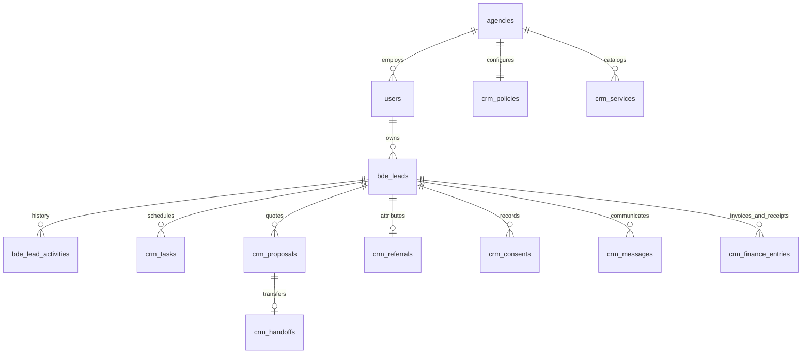

# Creo revenue workspace

The revenue workspace lives at `/bde/crm/overview`. It extends Creo's existing
React/Vite frontend, FastAPI authentication, agency tenancy, PostgreSQL,
staff reporting lines, notifications, and `bde_leads`/activity history. It does
not introduce a second identity system or a separate Next.js application.

## Roles

| Role | Record access | Management |
| --- | --- | --- |
| BDE (`bde`) / existing Sales (`sales`) | Assigned leads, tasks, proposals, messages, finance, personal reports; referrals originally sourced by them | Qualification, activities, tasks, proposal drafts, reviewed imports |
| BDE Head (`bde_head`) | Own records and BDEs reporting through `staff_profiles.team_lead_id` or Creo team membership | Assignment within their team, exact-version proposal approval, referral review, monthly BDE targets, invoices/receipts, delivery handoff |
| Admin / Super Admin | Their current agency | Staff accounts, reporting structure, letterhead, pricing catalog, policy, team oversight |
| Creative Team Lead, Editor, Designer, Client | No internal revenue workspace access | Clients can use an expiring proposal-specific link |

Every internal request checks the current active user, role, agency, password-reset
state and token version. New tables enforce agency RLS and lead/agency foreign
keys. Legacy `/bde` APIs use the same ownership scope, so opening an older page
does not widen access. A separate BDE Head role is intentional; creative Team
Lead permissions do not implicitly include sales data.

## Pages and behavior

- **Action center:** current pipeline; new leads, booked, invoiced and collected
  values for a selected local reporting month; due work; exception queue; target
  progress; personal or team scorecards.
- **Leads:** searchable responsive cards, contact details, owner, temperature,
  independent stage, next action, qualification evidence and activity history.
  Creation requires an owner and a future first action. International phone and
  normalized email duplicates are checked under an agency lock.
- **Pipeline:** stage columns with the same records and filters retained in the URL.
  Lost/disqualified/nurture outcomes need a reason. Won needs a confirmed booked
  amount; it does not imply payment.
- **Follow-ups:** persistent tasks, completion outcomes, required next action for
  an active lead's last task, snooze reasons, due ordering and one-time owner/head
  reminders. Snoozing resets the reminder marker.
- **Proposal studio:** client-bound catalog or custom lines, exact server-side
  minor-unit arithmetic, line discounts/taxes, separate recurring periods,
  discount floors, head approval and versioned client links. Issued PDFs are
  stored in PostgreSQL and served unchanged; a database trigger prevents changes
  to issued scope, pricing and PDF bytes. Revision revokes earlier links.
- **Referrals:** original acquiring BDE is immutable. Duplicate lead attribution
  is rejected; verification/qualification is a manager action.
- **Messages:** internal drafts, explicit permission evidence, scheduled approved
  Meta text templates, signed inbound/status webhooks, immediate reply/opt-out
  suppression, monotonic delivered/read updates and blocked ambiguous retries.
- **AI workspace:** editable CRM-grounded suggestions and their evidence;
  licensed provider search, duplicate review and explicit import. A signed
  discovery result expires after ten minutes and belongs to one user/agency.
  Unverified contact fields are withheld; import does not create consent.
- **Reports:** separate booked/invoiced/collected measures and dated receipt
  references. Heads can set per-BDE monthly booked targets.
- **Delivery handoffs:** accepted proposal snapshot, client scope and accountable
  delivery lead; created only after a confirmed win.
- **Settings:** CRM staff creation (mandatory password reset), head assignment,
  agency letterhead, reporting timezone/currency, thresholds, quiet hours,
  message frequency and service prices. Updating a SKU changes catalog defaults,
  not saved proposal snapshots.

## Schema



Proposal `family_id` and version identify revisions; `(agency_id, number, version)`
is unique. Monetary fields in the new module are minor units. The existing
`bde_leads.estimated_deal_value` remains in whole units for compatibility and is
explicitly converted in reports. Per-BDE/month targets are audited agency policy
entries. Booked value uses the explicit won amount/date; old converted records
without those facts are not assigned invented dates or collection amounts.

## API

All internal routes are under `/api/v1/crm` and use Creo bearer authentication.
The generated FastAPI OpenAPI contract contains request schemas and enum values.

| Area | Routes |
| --- | --- |
| Dashboard/team | `GET overview`, `GET team`, `GET/PUT team-admin`, `POST team-admin/accounts`, `PUT targets` |
| Leads | `GET/POST leads`, `GET leads/{id}`, `POST leads/{id}/qualify`, `/stage`, `/assign`, `/activities`, `/consent` |
| Tasks | `GET/POST tasks`, `POST tasks/{id}/action` |
| Proposals | `GET/POST proposals`, `POST proposals/{id}/action`, `GET proposals/{id}/pdf` |
| Referrals | `GET/POST referrals`, `POST referrals/{id}/review` |
| Outcomes | `GET/POST finance`, `GET/POST handoffs`, `GET delivery-team` |
| Providers | `GET integrations`, `POST ai/suggestions`, `POST discovery/search`, `POST discovery/import` |
| Messages | `GET/POST messages`, `GET whatsapp/templates`, `POST messages/{id}/schedule` |
| Configuration | `GET/POST catalog`, `GET/PUT settings`, `POST imports` (preview/commit CSV) |

External proposal routes are `/api/v1/public/crm/proposals/{token}` with `/pdf`
and `/decision`. The URL contains a tenant prefix plus a 384-bit secret, stored
only as a hash; no login or arbitrary client-record lookup is offered.

WhatsApp callbacks use `/api/v1/public/crm/whatsapp/{agency_id}`. GET verifies the
provider challenge; POST verifies the raw-body HMAC before any records are read.
Meta's [template message reference](https://whatsapp.github.io/WhatsApp-Nodejs-SDK/api-reference/messages/template/)
and [webhook signature reference](https://whatsapp.github.io/WhatsApp-Nodejs-SDK/api-reference/webhooks/start/)
describe the provider contracts used here. Run the actual connected account's
sandbox tests before enabling production sends.

## Setup and deployment

1. Install backend requirements, including ReportLab, and frontend dependencies.
2. Run `alembic upgrade head` from `backend`. Migration `0026_revenue_crm` adds the
   two roles and nine revenue tables, preserves existing leads, and carries
   forward existing assigned follow-up dates into durable tasks.
3. Deploy the API and frontend together. The API lifespan starts the due-task
   and WhatsApp dispatcher once per minute; locking makes multiple API replicas
   safe. Hosting sleep or quotas can delay this process. A paid plan was not added.
4. As an agency admin, open CRM Settings, configure branding/prices, create BDE
   and BDE Head accounts, then assign reporting heads. Assign existing agency
   leads where appropriate; records with no owner appear in the admin exception
   queue, not every BDE's inbox.
5. Set provider credentials in managed backend secrets only. Nothing is placed
   in frontend environment variables or returned in API configuration responses.

`CRM_WHATSAPP_CONNECTIONS` is JSON keyed by agency UUID. Each value contains
`token`, `phone_number_id`, `business_account_id`, `app_secret`, and `verify_token`.
The existing `META_GRAPH_API_VERSION` selects the Graph version. Configure and
subscribe the signed webhook in Meta. Supported templates contain body/footer
text and numbered body parameters; media/header/button templates are rejected.
Every queued job rechecks contact permission and provider approval. `submitting`
or `uncertain` messages are never automatically resent; investigate provider
history before any manual correction. A reply suppresses scheduled follow-ups;
STOP/UNSUBSCRIBE also appends an opt-out record.

`CRM_LEAD_PROVIDER_CONNECTIONS` is JSON keyed by agency UUID. Each value contains
an agency-authorized HTTPS `url`, bearer `token` and provider `name`. The adapter
POSTs `{query, location, limit}` and expects `{companies: [...]}`. Each company
contains `source_id`, `company_name`, optional `contact_name`, `phone`, `email`,
`website`, `location`, `industry`, `source_url`, `contact_verified` and
`storage_permitted`. The agency/provider must establish rights to store these
fields; unknown permission prevents import. No arbitrary search URL can be
supplied by a BDE. A direct commercial-provider-specific adapter can implement
this contract once that provider is selected.

AI uses Creo's existing Gemini client and secret configuration. Suggestions are
reviewable and cannot execute CRM actions. Each agency has a daily CRM AI call
budget, and essential workflows do not depend on AI availability.

## Verification

Use a migrated disposable local PostgreSQL database named `creo_test_*`:

```powershell
$env:CRM_TEST_DATABASE_URL = 'postgresql+asyncpg://test_user@127.0.0.1:5432/creo_test_crm'
$env:DATABASE_URL = $env:CRM_TEST_DATABASE_URL
$env:DIRECT_DATABASE_URL = $env:CRM_TEST_DATABASE_URL
alembic upgrade head
python -m pytest tests/test_revenue_crm.py tests/test_revenue_crm_database.py -q
```

The database suite creates a restricted runtime role to exercise forced RLS;
its disposable database setup user therefore needs test-only role/grant
privileges. Never point this suite at production. Test coverage includes
cross-BDE and cross-agency denial, direct SQL RLS, duplicate imports, next-action
rules, exact pricing, approvals, immutable versions, PDF equality, token expiry/
revocation paths, referral attribution, targets, actual receipts, signed webhook
replay/status ordering, suppression and one-time reminders. Build with
`npm run build --prefix frontend`.

For the reproducible browser journey, use the same disposable migrated database:

```powershell
$env:CRM_BROWSER_TEST_DATABASE_URL = $env:CRM_TEST_DATABASE_URL
python -m uvicorn crm_browser_server:app --app-dir tests --host 127.0.0.1 --port 8009
```

In separate terminals run Vite on `127.0.0.1:5181` and
`python backend/tests/browser_revenue_crm.py` from the repository root. The test
server is a localhost-only fixture application with stubbed authentication;
never deploy it. The browser test uses real local CRM APIs/PostgreSQL for lead,
activity, proposal, head approval and client acceptance, then checks desktop and
mobile pages. Screenshots are written under `.wrangler/crm-*.png`.

## Specification items beyond this implementation

The supplied specification is broader than this release. The visual sequence
builder with multi-step retries, XLSX/file attachments, fuzzy company merge with
an administrative reconciliation preview, holiday-aware automatic routing,
multiple WYSIWYG letterhead templates/logo uploads, calendar/email sync, fiscal
reporting calendars, predictive forecasts and e-sign providers are not implemented
here. The connected Meta account and chosen licensed provider still need sandbox
and live validation. The generic discovery adapter is not a claim that a specific
paid provider is already integrated. Production readiness for those capabilities
must not be inferred from the core CRM test results.

Platform Super Admins select an active agency above the CRM workspace. Every
query cache and request uses that selected agency; BDE and BDE Head accounts
remain bound to their own agency regardless of a supplied selection header.
